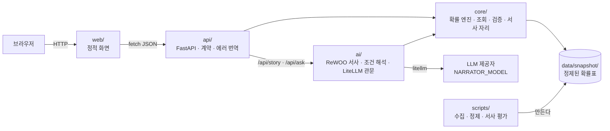
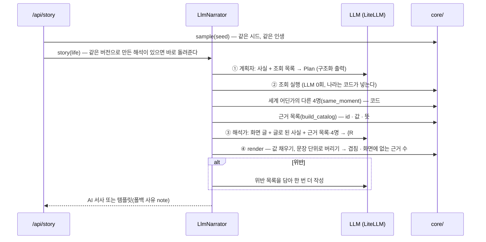

# 아키텍처

## 층 그림



## 층별 책임

| 층 | 한다 | 안 한다 |
|---|---|---|
| `web/` | 입력 받기, 결과 그리기, 진행·에러 표시 | 확률 계산, 데이터 해석 |
| `api/` | 요청 검증(Pydantic), 코어 호출, 에러를 HTTP 상태로 번역 | 확률 계산, 통계 보관 |
| `core/` | 조건부 확률 체인, 뽑기, 역확률, 목표 달성 횟수, 맥락 조회, 숫자 검증, 서사 자리 | HTTP, 모델 호출 |
| `ai/` | LLM 호출(구조화 출력·재시도·폴백·비용 장부·예산), ReWOO 서사, 자연어 → 역확률 조건 해석, 버전 기준 캐시 | 숫자 계산 — 조회와 검증은 `core/`를 부른다 |
| `prompts/` | 계획자·해석가·조건 해석기 프롬프트 원문 | 코드에 프롬프트를 박지 않는다(고친 것이 diff로 보이게) |
| `data/snapshot/` | 정제된 확률표와 출처·연도 기록 | 원본(raw)은 두지 않는다 |
| `scripts/` | 원본 수집, 정제, 리포트 | 서비스 실행 중에는 돌지 않는다 |

## 개인정보

- 사용자의 '내 실제 나라'는 브라우저 `localStorage`에만 둔다. 화면은 `GET /api/profiles`로 모든 나라의 지표를 받아
  그 안에서 고르므로, 서버로 가는 요청에는 비교 기준 나라가 실리지 않는다. 이 엔드포인트는 입력을 받지 않는다(테스트로 지킨다).
- 공유 링크에는 시드(와 국가를 고정했다면 그 국가)만 들어간다.

## 경계 세 개

1. **숫자는 `core/`만 낸다.** 화면도, API도, LLM도 확률을 계산하지 않는다.
   모든 숫자의 출처는 `data/snapshot/`의 표와 `core/`의 순수 함수다.
2. **`core/`는 문도 모델도 모른다.** `core/`는 FastAPI도 LiteLLM도 import하지 않는다. import 방향은
   `api → ai → core`, `api → core` 뿐이다.
3. **모델은 판단만 하고, 판정은 코드가 한다.** 어떤 조회를 할지, 어떤 문장으로 쓸지는 모델이 정하고,
   어느 나라를 조회할지와 서사의 숫자가 맞는지는 코드가 정한다.

## AI가 들어갈 자리

**자리는 둘이다(2026-10-18~).** ① 뽑힌 사실로 화면에 없는 해석을 쓴다(`Narrator`, 이 절). ② 자연어 질문을 역확률 조건으로 옮긴다(`TargetParser`, 맨 아래 절). 둘 다 숫자는 내지 않는다.

```python
# core/narrator.py
class Narrator(Protocol):
    name: str
    def narrate(self, life: Life) -> Narrative: ...
```

| 구현 | 언제 | 무엇을 하나 |
|---|---|---|
| `ScriptedNarrator` (`core/narrator_scripted.py`) | v0.2~, 키가 없거나 LLM이 실패할 때 | 사실 목록을 정해진 문장에 끼워 넣는다. 화면에 "템플릿 서사"로 표시 |
| `LlmNarrator` (`ai/narrator_llm.py`) | v0.5~, `/api/story` | **해석가**(2026-10-11~): 템플릿 아래에 화면에 없는 비교만 덧붙인다 |

- 템플릿 서사는 언제나 화면에 있다. AI는 그것을 다시 쓰지 않고, 버튼을 누르면 그 아래 "AI 해석"을 덧붙인다.
- 해석의 재료는 템플릿이 쓰지 않는 근거다: 위치 한 줄의 지표를 세계와 견준 값(코드가 늘 넣음), 이웃 나라,
  세계 어딘가의 다른 4명(`peer_facts`, 화면 이름 — 코드는 `same_moment`).
- **숫자는 참조로**(2026-10-18~, `core/references.py`): 코드가 근거마다 id·값·뜻을 붙인 목록(`build_catalog`)을 주고,
  해석가는 숫자 대신 `{R7}`처럼 가리킨다. 값·단위·순위 방향("높은 쪽에서 13번째(196개국 중)")은 코드가 채우고(`render`),
  바로 뒤 조사도 받침에 맞춘다. 목록에는 통계가 있는 값만 오른다(None은 빠진다).
- **문장 하나 단위로 버린다**(`check_sentence`): 직접 친 숫자, 없는 id, 깨진 참조, 쓰지 않는 말(훈계·운 평가 —
  `BANNED`), 지표·나라 이름 없이 쓴 비교 값, 순위 방향 뒤집기, 사망 수 옆의 '살아남'. 나머지 문장은 살린다.
- 남은 글로 두 가지를 더 본다: 화면 글과 겹치는 비율이 35% 이하인가(`overlap_ratio`), 화면에 없는 근거(새 참조·
  다른 4명의 나라 이름)를 둘 이상 썼는가(`novel_used`). 모자라면 버린 문장과 이유를 알려 한 번 다시 쓰게 하고,
  그래도면 해석을 붙이지 않는다(템플릿만 남는다).
- **버전 기준 캐시**: 키 = (데이터 지문 · 프롬프트와 도구 설명 지문 · 모델, 시드, 뽑힌 값). 셋 중 하나라도 바뀌면
  예전 해석을 쓰지 않는다. 시간(TTL)으로는 버리지 않는다. 성공한 해석만, 프로세스 메모리에 최대 512건(LRU).
  다시 꺼낸 해석은 모델 호출 0회 · 비용 0이고, 화면에 그렇게 표시한다(`cached`).
- AI가 없어도(키 없음·한도·예산·장애) 뽑기·역확률·템플릿 서사는 전부 동작한다.

## AI 서사의 흐름 (ReWOO)



| 실패 | 처리 |
|---|---|
| 스키마에 안 맞는 출력 | 오류를 보여 주고 같은 모델에 한 번 더 |
| 직접 친 숫자 · 없는 참조 · 쓰지 않는 말 · 뜻 없는 비교 값 | 그 문장만 버린다 |
| (버리고 남은 글이) 화면 글 반복 / 새 근거 부족 | 버린 문장과 문제를 알려 한 번 더 쓰게 하고, 그래도면 해석을 붙이지 않는다 |
| 429 요청 한도 | LiteLLM 재시도 후 템플릿 + "잠시 후 다시" 안내 |
| 제공자 장애 | `NARRATOR_FALLBACKS` 폴백 모델 → 그래도면 템플릿 |
| 누적 비용이 `STORY_BUDGET_USD` 도달 | 더 부르지 않고 템플릿 |

## 자연어로 묻는 역확률 (`ai/target_parser.py`)

"서울에서 일하는 여자로 태어날 확률은?" → `TargetParser.parse` → `Target` → `Engine.probability()` (기존 그대로).

- **모델은 목록 안에서 고르기만 한다.** 고를 수 있는 값은 `core/model.py`의 `target_choices(snapshot)` 하나에서 나오고,
  구조화 출력 스키마의 칸마다 enum으로 박힌다(국가 ISO3 217개, 성별·생존·경제·고용, 한국 상세가 있으면 시도·직업 코드).
  목록 밖 값은 스키마에서 걸려 한 번 고쳐 오게 하고, 마지막으로 `Engine.check_target`이 거부한다.
- **근거 말(`readings`)**: 칸마다 질문의 어느 말에서 왔는지 남겨 화면이 해석을 보여 준다.
- **지어내지 않는다(`dropped`)**: 통계가 없는 조건(키, MBTI …)과 뜻이 하나로 정해지지 않는 말("부잣집")은 이유와 함께 뺀다.
- **칸 사이 규칙은 코드가 건다**: 한국 칸이 있으면 국가는 대한민국. 다른 나라와 한국 칸이 함께 오면 나라를 따르고
  한국 칸을 뺀다. 고용·직업이 5세 생존을 함께 거는 규칙은 원래 `probability()`에 있다.
- 질문은 200자에서 자르고 경계 마커로 감싼다(데이터로만 다룬다).
- 같은 질문(공백 정리)은 서사와 같은 버전 기준 캐시(`ai/cache.py`, 데이터·프롬프트·모델 지문)로 모델을 다시 부르지 않는다.
- 모델 실패(장애·한도·예산)는 예외로 올리고, 어떻게 알릴지는 문(`api/`)이 정한다.

